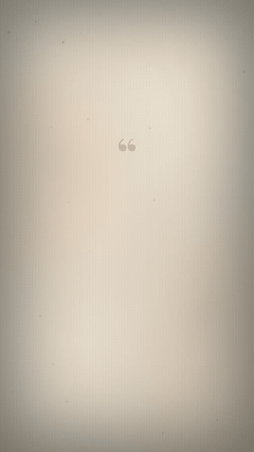

# Remotion Quote Shorts

Render cinematic vertical quote videos (1080×1920) from a single TypeScript content file. No timeline, no After Effects — the content file *is* the edit.



## Quick start

```bash
npm install
npm run dev        # open Remotion Studio
npm run render     # → out/quote.mp4
```

## Make it yours

Edit `src/content/my-quote.ts`:

```ts
export const props: QuoteVideoProps = {
  theme: "paper",        // midnight | neon | sunset | paper | terminal
  quote: "Your quote here.",
  author: "Author name",
  authorTitle: "Source or work",
  cta: "Follow for more",
};
```

Duration is derived automatically from the quote length — words materialize one by one, then the author card fades in, with a slow push-in across the whole video.

## Props

| Prop          | Type      | Notes                                    |
| ------------- | --------- | ---------------------------------------- |
| `theme`       | ThemeName | `midnight` `neon` `sunset` `paper` `terminal` |
| `quote`       | string    | Word-by-word reveal                      |
| `author`      | string    | Shown in the author card                 |
| `authorTitle` | string    | e.g. book title                          |
| `cta`         | string    | Bottom call-to-action line               |
| `showCta`     | boolean   | optional, default true                   |

## Part of Faceless Shorts Kit

This is the free `QuoteVideo` template from **[Faceless Shorts Kit](https://shortkit.gumroad.com/l/faceless-shorts-kit)** — 7 formats (Reddit stories, fake-text convos, listicles, quizzes, caption overlays, bar-chart races) that all render from one typed content file. Featured on the [official Remotion resources](https://remotion.dev/resources) page.

## License

MIT — use it for anything.
